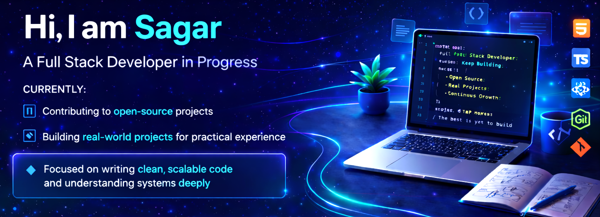

  

 

## About

- I am a B.Tech CSE student focused on becoming a full stack developer.
- I build real-world projects to gain practical experience, focusing on strong fundamentals and user-centered solutions.
- I am also interested in contributing to meaningful open source projects.

---

## Tech Stack

---

## Featured Projects

### [FlowSite](https://github.com/itssagarK/flowsite) - Visual website builder that exports clean, ready-to-host HTML

- Templates for portfolios, business sites, and landing pages
- Interactive 3D backgrounds for modern UI
- AI-assisted content generation from a resume or screenshot
- One-click export (GitHub Pages, Vercel, Netlify)

### [Edito](https://github.com/itssagarK/edito) - High-performance, 100% on-device video editor for Android

- Multi-track timeline with magnetic snapping and ripple editing
- Real-time GPU effects with a smooth 60 FPS preview
- Deterministic FFmpeg rendering pipeline with 720p, 1080p, and 4K export
- Fully offline and private: no cloud uploads, no account, no telemetry
- Built with Flutter and Dart, with APK releases on GitHub

### [GitHub Helper](https://github.com/itssagarK/githubhelper) - Helps you use GitHub in many different ways

- Convert your thoughts to Markdown with live preview
- Profile Builder to help you create a visually appealing profile
- Built-in badges, templates, and GitHub Actions
- Templates for basic and advanced READMEs, PRs, issues, etc.

### [NeutralKit](https://github.com/itssagarK/neutralkit) - A system dashboard built for contributors of Neutralinojs

- Visualizes real system data using native APIs
- Helps track and organize contributions interactively
- Includes history and recovery features for better usability

### [ArthaMitra](https://github.com/itssagarK/aarthmitraa) - An AI-powered, gamified financial literacy app built for everyday Indians

- Simulates real-life financial decisions (EMIs, expenses, trade-offs)
- Tracks impact across Savings, Health, Joy, and Relationships
- Designed for practical financial awareness through interaction

### [Reality Check AI](https://github.com/itssagarK/Reality-check-2) - A constraint-based planning audit tool that evaluates real-world feasibility

A practical tool designed to analyze whether your plans will actually work based on time, resources, and execution limits:

- Evaluates feasibility with a structured scoring system (0–100)
- Identifies realistic failure points before execution begins
- Analyzes dependencies, risks, and resource gaps
- Suggests actionable alternative approaches
- Defines clear stop signals to prevent wasted effort

---

## GitHub Stats

<table align="center">
<tr>
<td>

</td>
<td>

</td>
</tr>
</table>

---

## Activity

---

## Connect

---
